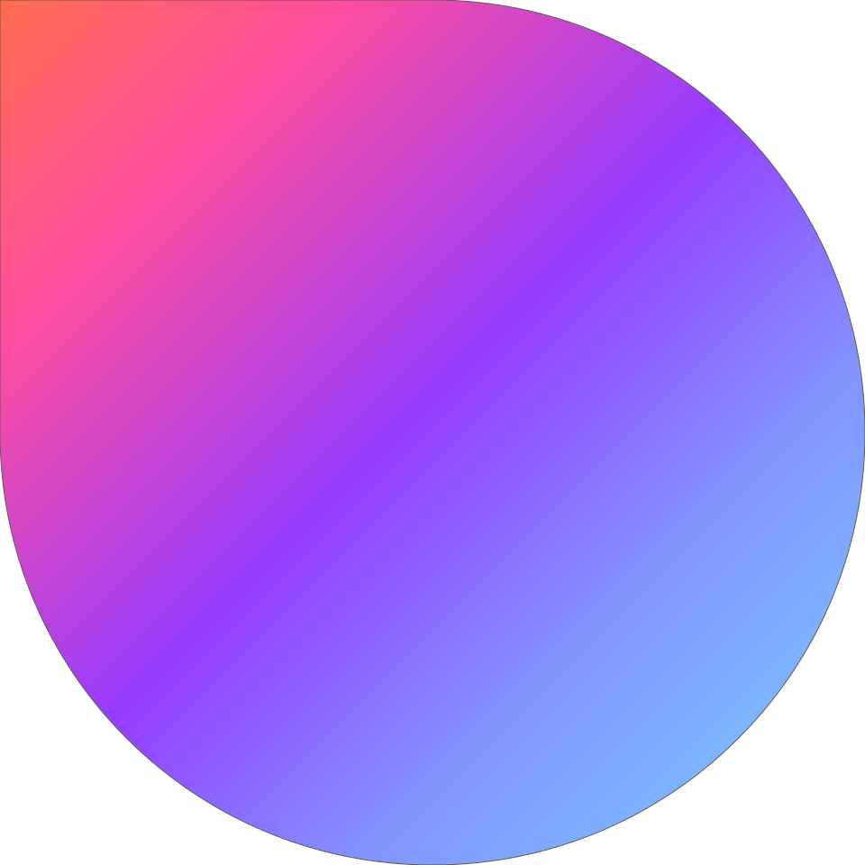

#  NAISR: A 3D Neural Additive Model for Interpretable Shape Representation

Pytorch implementation for our `ICLR 2024 Spotlight` paper <br>
[NAISR: A 3D Neural Additive Model for Interpretable Shape Representation](https://arxiv.org/abs/2303.09234), ICLR 2024. <br>
Yining Jiao, Carlton Zdanski, Julia Kimbell, Andrew Prince, Cameron Worden, Samuel Kirse, Christopher Rutter, Benjamin Shields, William Dunn, Jisan Mahmud, Marc Niethammer. <br>
UNC-Chapel Hill

#### [Paper](https://arxiv.org/abs/2303.09234) | [Project Page](https://uncbiag.github.io/NAISR/) | [Demos](https://colab.research.google.com/drive/1OudGynEydIXpAgfA9lvi5d0L86kK-uwg?usp=sharing)


<div align=center></div>

Please cite as:
```
@inproceedings{
jiao2024naisr,
title={\texttt{NAISR}: A 3D Neural Additive Model for Interpretable Shape Representation},
author={Yining Jiao and Carlton Jude ZDANSKI and Julia S Kimbell and Andrew Prince and Cameron P Worden and Samuel Kirse and Christopher Rutter and Benjamin Shields and William Alexander Dunn and Jisan Mahmud and Marc Niethammer},
booktitle={The Twelfth International Conference on Learning Representations},
year={2024},
url={https://openreview.net/forum?id=wg8NPfeMF9}
}
```


An update is coming soon


## Installation
The code is tested with ``python=3.9``, ``torch=2.1.0``, ``torchvision=0.15.2``.
```
git clone https://github.com/uncbiag/NAISR
cd NAISR
```
Now, create a new conda environment and install required packages accordingly.
```
conda create -n naisr python=3.9
conda activate naisr
pip install -r requirements.txt

## Getting Started
First, download three model weights: vitb_sax1 (408M), vitb_sax2 (435M), and vitb_sax2_ft (435M). These weights will be automatically saved to the ``weights`` folder.
```
python download.py
```
```
Run interactive GUI with the downloaded weights. The ``assets`` contains images for demo.
```
./run_demo.sh
```

We train and test our method on three datasets: Starman, ADNI Hippocampus, and Pedeatric Airway.

| Dataset   |                      Description             |           Dataset Link              |   Model Link              |
|-----------|----------------------------------------------|:------------------------------------:|:------------------------------------:|
|Starman      |  simulated 2D Starman shapes      |  [simulation code)][StarmanData]          | [weights][StarmanModel]    | 
|ADNI Hippocampus  |  1632 hippocampus from ADNI     |  [official site][ADNIData]              | [weights][ADNIModel]  |
|Pedeatric Airway |  357 pediatric airway shapes      |  NA | [weights][AirwayModel]               |


[ADNIData]: https://ida.loni.usc.edu/login.jsp?project=ADNI
[StarmanData]: 

[ADNIModel]: https://github.com/uncbiag/NAISR/releases/download/naisr_weights_v0/naisr_weights_adni.pth
[StarmanModel]: https://github.com/uncbiag/NAISR/releases/download/naisr_weights_v0/naisr_weights_starman.pth
[AirwayModel]: https://github.com/uncbiag/NAISR/releases/download/naisr_weights_v0/naisr_weights_pediatric_airway.pth

Instructions on the way...


## Cite this work
```
@inproceedings{
jiao2024naisr,
title={\texttt{NAISR}: A 3D Neural Additive Model for Interpretable Shape Representation},
author={Yining Jiao and Carlton Jude ZDANSKI and Julia S Kimbell and Andrew Prince and Cameron P Worden and Samuel Kirse and Christopher Rutter and Benjamin Shields and William Alexander Dunn and Jisan Mahmud and Marc Niethammer},
booktitle={The Twelfth International Conference on Learning Representations},
year={2024},
url={https://openreview.net/forum?id=wg8NPfeMF9}
}
```
